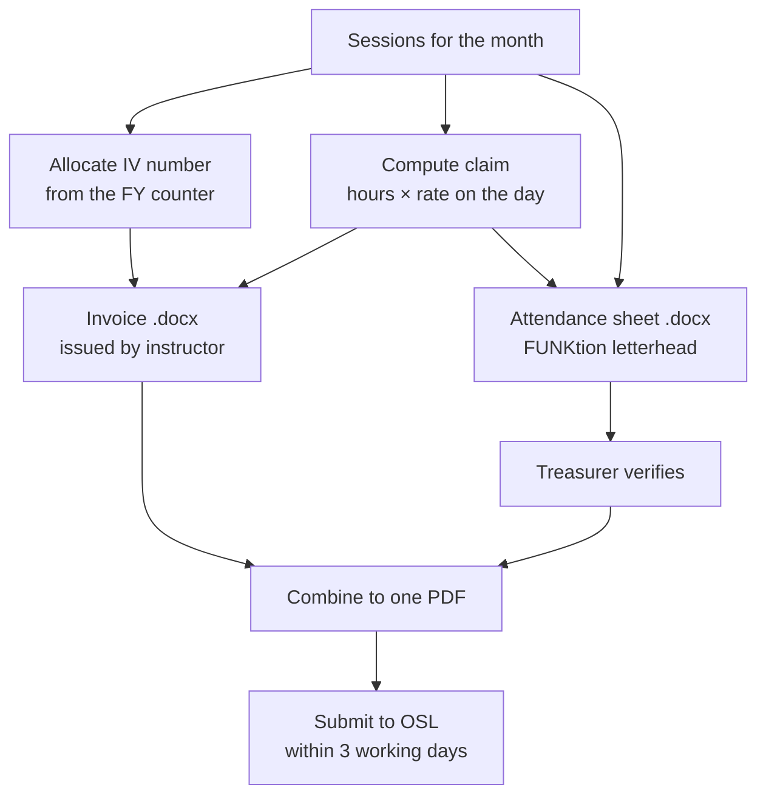

<div align="center">


# FUNKtion Treasury

**The treasury portal for FUNKtion — SUTD's popping &amp; locking dance club.**

Every fact gets entered once. Every document is a rendering of it.

[](https://nextjs.org)
[](https://react.dev)
[](https://www.typescriptlang.org)
[](https://www.prisma.io)
[](https://supabase.com)
[](#testing)


</div>

## What this is

The treasurer's month is mostly transcription. The same four facts — which classes ran, who
attended, what the instructor is owed, which fund it comes from — get typed into an invoice, an
attendance sheet and a register by hand, on the 15th of every month. Fee collection is worse: the
club has never kept a record of who actually paid, only a lump sum banked once a term.

This portal makes each of those facts get entered exactly once, and derives every document from
them. It is written against the **SUTD Student Organisations Finance Guidelines (September 2025)**,
and the rules in that document are implemented as validations rather than reminders.

> The full design rationale — schema, artefact classes, phasing, open questions — lives in
> **[`docs/implementation-plan.html`](docs/implementation-plan.html)**. Open it in a browser.


## What it produces

Two classes of artefact, and the distinction drives most of the technical decisions:

| Class | Documents | Format | How the portal treats it |
| :--- | :--- | :--- | :--- |
| **A** | Transaction Register, Unofficial Funds Register | Google Sheets | Edited in place via the Sheets API, behind a diff-and-approve gate with a pre-write snapshot |
| **B** | Invoices, attendance sheets, income deposit forms, PRF, PAF | `.docx` | Composed server-side, handed to the browser as a download. Never written back to Drive |

Class B needs no Google credentials at all, which keeps the trusted surface small. Only the
register requires API access.

### Built today

- **Coach invoice** (`.docx`) — issued *by* the instructor, billed to SUTD, countersigned by the
  club. Rebuilt from the two templates in Drive, which had drifted apart and acquired separate
  faults (shifted column headers, the payee block collapsed into the treasurer's signature, four
  hardcoded lesson rows).
- **Coaches Monthly Attendance Sheet** (`.docx`) — the club's own document, on FUNKtion
  letterhead, verified by the Treasurer. A member-by-date matrix of YES/NO with the instructor as
  its first row.
- **Reference numbering** — the four OSL series, allocated atomically.

Both documents derive from one list of sessions, so they cannot disagree about how many classes
the coach actually taught.


## The monthly run



A date where the instructor's row reads **NO** is a self-practice session: the club met, the
attendance counts, and nobody bills for it. A month with only self-practice produces an attendance
sheet and no invoice — that is a normal month, not an error.


## Quick start

**Requirements:** Node 20+, Docker (for the local Supabase stack).

```bash
cp .env.example .env
docker compose up -d
```

GoTrue and the Storage API run their own internal migrations on boot. Wait for those to settle,
then:

```bash
npm install
npm run db:deploy    # apply application migrations
npm run db:seed      # opening state for FY2026
npm run dev
```

Open <http://localhost:3000>.

For the local stack, `.env` must keep `NEXT_PUBLIC_SUPABASE_URL` at `http://localhost:8000` (Kong,
not the Postgres port and not GoTrue directly), use the anon JWT as
`NEXT_PUBLIC_SUPABASE_PUBLISHABLE_KEY`, and use the service-role JWT only as the server-side
`SUPABASE_SECRET_KEY`. Change the example JWTs, database passwords and autoconfirm settings before
using the stack for anything beyond local development. The first-boot SQL in `supabase/init.sql`
only runs when the Postgres volume is initialised for the first time.

### What the seed sets up

| | |
| :--- | :--- |
| Organisation | `funktion`, project code **097**, Arts cluster (A3006) |
| Fund accounts | `PC-00097-A3006-A3006-000` (Seed, no rollover) · `PN-00097-A3006-A3006-000` / `-R00` (Income) |
| Counters | **IV @ 0010**, SCF/PO/INC @ 0001 |
| Instructors | JIN (Locking), KS (Popping) at $90.00/hr from 1 Apr 2026 |

IV opens at 0010, not 0001: numbers 0001–0009 are already on documents sitting with the Office of
Finance. Instructor addresses and bank accounts are deliberately **not** seeded — they are personal
data belonging to someone who did not agree to have it in a git repository, so they are entered
once through the portal. Until they are, `assertInvoiceable()` refuses to generate that coach's
invoice.


## Architecture

A small platform **kernel** with feature **modules** registered on top of it. The kernel owns
auth, tenancy, permissions, audit, notifications, storage and the design system; it knows nothing
about invoices. Modules declare a manifest and the kernel derives nav, permissions and settings
from it.

```
src/
├── core/                 # the kernel — no domain knowledge lives here
│   ├── auth/             # Supabase SSR clients, DAL, org context
│   ├── db/               # dbAs() = RLS-scoped · dbAdmin() = bypasses RLS, core-only
│   ├── permissions/      # registry + kernel-owned permissions
│   ├── modules/          # module manifests → nav, permissions, settings
│   ├── audit/            # actor, before, after — on every financial write
│   ├── notifications/    # in-app + email adapters, composed
│   ├── storage/          # private Supabase bucket, signed URLs
│   ├── events/           # in-process event bus
│   └── ui/               # primitives, charts, app shell
├── modules/
│   ├── coach-claim/      # invoice + attendance sheet, rates, money, claim assembly
│   ├── references/       # OSL labelling protocol + atomic allocation
│   └── register.ts       # import-time registration barrel
├── app/                  # Next.js App Router
└── proxy.ts              # session refresh + route protection
```

Outside `src/`: `prisma/schema/` is split by domain (`_base`, `identity`, `organisation`,
`finance`, `audit`); `templates/official/` holds the OSL forms the generated documents have to
satisfy, as reference rather than as input — nothing reads them at build time; `supabase/` holds
the first-boot SQL and Kong config for the local stack; `docs/` holds the implementation plan and
the brand assets this README uses.

### Three invariants worth knowing

**Money is integer cents, everywhere.** The OSL register quotes two decimals and derives the net
from the gross by division (`net = gross / 109 × 100`), so a float representation drifts against
the very document the portal has to reconcile with. `sessionAmountCents()` rounds once — a 90-minute lesson at $90/hr is
`$135.00`, and no arrangement of the same numbers is allowed to produce `$134.99`.

**Reference numbers are allocated, never computed.** A single atomic `UPDATE … RETURNING` against
the counter row, inside the same transaction that writes the document, with a unique constraint on
`(series, financialYear, sequence)`. Application-level `max + 1` is the classic way to issue the
same invoice number twice under concurrency, and it stays invisible until OSL rejects a
submission. A missing counter throws rather than defaulting to `0001` — guessing would reissue
numbers already in circulation.

**Rates resolve per session, not per invoice.** "The instructor's rate" is only meaningful with a
date attached: rates rise at term and year boundaries, and guests are booked per workshop. A month
that straddles a rise bills correctly on both sides without anyone noticing it straddled one. A
missing rate throws — inventing one produces an invoice that looks authoritative and is wrong.

### Access control

Two roles. **Exco** see and do everything; **members** see their own record and nothing else.
Alongside the role, an exco member holds an *office* (president, treasurer, secretary…) which
confers no access at all — it only decides who gets notified and whose title prints under a
signature. Keeping offices as labels means a mid-year reshuffle is a dropdown rather than a
security decision.

Authorisation is server-side on every mutation, with Postgres row-level security intended as
defence in depth. `dbAs()` opens a transaction as `app_user` with the caller's JWT claims
installed, so every query inside it is evaluated by RLS; `dbAdmin` bypasses RLS and is confined to
`src/core/**` by an ESLint boundary rule, alongside a second rule keeping the kernel from importing
modules. Amounts are always computed server-side — the browser never posts a dollar figure.

> [!IMPORTANT]
> **The database half of that is not in the migration set yet.** `prisma/migrations/` is a clean
> Prisma init: it creates tables, and no roles, policies, grants or the `write_audit_log()`
> function. The HR kernel's hardening migrations did not survive the schema rewrite.
>
> This fails loudly rather than quietly: `dbAs()` checks `current_user` inside the transaction and
> raises `RlsScopeError` rather than running as the table owner, so there is no silent window where
> queries appear to work while RLS is absent. `scripts/ci/verify-grants.sql` skips with a notice
> until the role exists and arms every assertion the moment it does. Writing that migration is the
> next piece of work on the data layer.


## Rules the portal enforces

These are validations applied before a document will generate or submit, not reminders. Each one
lands with the phase that owns it — the coach-document rules below are live today; the fee,
procurement and register rules arrive with phases 02, 04 and 05.

| Rule | Source | Enforcement |
| :--- | :--- | :--- |
| Income carries 9% GST; donations are exempt | §2 | GST derived, never entered |
| Income Deposit Form due within 1 working day of final collection | §2.2 | Countdown + reminder |
| OSL told 2 weeks before collection to open the DBS Max wallet | §2.2 | Blocks opening a term whose lead time has lapsed |
| Seed Fund does not roll over; cut-off around end of February | §2.3 | Hard deadline on the fund account |
| Purchases below $300 → PRF, treasurer only | §3.1.1 | Form type derived from the amount, never chosen |
| $300–$999.99 → PAF, 3 quotations, treasurer + president | Table 1 | Cannot submit with fewer quotes unless an exemption is recorded |
| $1000 and above → PAF, 3 quotations, + OSL approval | Table 1 | Adds a third approval stage |
| Approval must precede the purchase | §3.1.1 | Purchase date cannot precede final approval |
| Invoice to OSL within 3 working days, as one PDF | §3.1.2 | Due date computed on generation |
| Coach documents submitted by the 15th of the following month | §3.3 | Drives the monthly run |

### Reference numbering (§4.4)

Four independent series, each resetting to `0001` at the start of the financial year (April–March).
The hyphens are mandatory.

| Series | Document | FY2026 form |
| :--- | :--- | :--- |
| `IV` | Invoice | `IV26-097-0008` |
| `SCF` | Student Expense Claim | `SCF26-097-0001` |
| `PO` | Purchase Order | `PO26-097-0001` |
| `INC` | Income Deposit Form | `INC26-097-0001` |

Issued numbers are never deleted. Voiding a document marks the number void with a reason, so a gap
in the series has an answer.


## Scripts

| Command | What it does |
| :--- | :--- |
| `npm run dev` | Development server |
| `npm run build` / `start` | Production build and serve |
| `npm run lint` | ESLint, including the `dbAdmin` boundary rule |
| `npm run test` / `test:run` | Vitest, watch / single-run |
| `npm run test:db` | Adds the tests that need a real Postgres (`RUN_DB_TESTS=1`) |
| `npm run test:e2e` | Playwright |
| `npm run db:migrate` | Create and apply a migration in development |
| `npm run db:deploy` | Apply pending migrations to the target database |
| `npm run db:push` | Push schema without a migration (local only) |
| `npm run db:studio` | Prisma Studio |
| `npm run db:seed` | Opening state for FY2026 (idempotent) |

## Testing

```bash
npm run test:run
```

177 unit tests across 18 files, covering money and rate arithmetic, claim assembly, document
composition, the reference protocol and atomic allocation, plus the kernel's permissions, audit,
notifications, module registry and UI primitives. The database-backed tests are opt-in behind
`RUN_DB_TESTS=1` so the default run needs no Postgres.

CI (`.github/workflows/ci.yml`) runs typecheck, lint and unit tests, then applies the full
migration set to a bare Postgres — with `scripts/ci/stub-supabase-schema.sql` standing in for the
Supabase platform schema — and runs `verify-grants.sql` against the result. That last check reports
its own state: it asserts the `app_user` / `authenticated` grant split when the role exists, and
skips with a notice while it doesn't, so a green build never reads as a security claim it isn't
making.

`npm run test:e2e` currently covers the auth pages only. The rest of the Playwright suite drove the
HR product's routes and went with it.


## Deployment

Once per environment, beyond `npm run db:deploy`:

1. **Migrations are not automatic.** `npm run build` (what Vercel runs) does not run
   `prisma migrate deploy`. Merging to `main` deploys the code; it does not apply schema or RLS
   changes. Run `npm run db:deploy` against the target database as its own explicit step after
   every merge containing a migration, and confirm it landed:
   ```sql
   SELECT migration_name, finished_at FROM _prisma_migrations ORDER BY finished_at DESC LIMIT 5;
   ```
2. **Storage bucket.** Nothing creates the private documents bucket automatically. Run
   `npx tsx scripts/create-storage-bucket.ts` once against the target project — it is idempotent.
   Skipping it means the first upload fails.
3. **Hosted Supabase connection role.** Once the RLS migration lands (see the note above), set
   `APP_USER_DATABASE_URL` to `app_user`'s own login credential. Hosted Supabase blocks `SET ROLE`
   to any role outside its platform allowlist, so without this the RLS-scoped client cannot reach
   `app_user`. Local and self-hosted Postgres have no such restriction and fall back to `SET ROLE`
   automatically.
4. **Self-hosted CORS origin.** `supabase/kong.yml` hardcodes `http://localhost:3000` as the only
   allowed origin. Edit the `origins` list before pointing a self-hosted deployment at a real
   domain.


## Roadmap

| | Phase | Status |
| :--- | :--- | :--- |
| **01** | Invoice and attendance generation | Document composition, rates and reference allocation in place |
| **02** | Fee collection — PayNow declaration, exco reconciliation, Income Deposit Form | Planned |
| **02b** | Attendance import from Drive, stored signatures | Planned |
| **03** | Telegram reminders alongside in-app and email | Planned |
| **04** | Procurement — PRF/PAF thresholds, quotations, approval chain | Planned |
| **05** | Transaction Register sync, behind diff-and-approve | Planned — held back deliberately; it is the only irreversible write to a shared artefact |
| **06** | Handover — FY2027 rollover, all four counters reset to 0001 | March 2027 |

The schema for every phase already exists in `prisma/schema/finance.prisma`; the phases above are
the UI and workflow on top of it.

### Known gaps

Phase 01's document layer is written and tested; the shell around it is not finished. Three
destinations are routed to but have no page yet, so a signed-in visitor 404s on arrival:

| Route | Reached from |
| :--- | :--- |
| `/{orgSlug}/dashboard` | `src/app/page.tsx` after sign-in, `[orgSlug]/page.tsx`, the sidebar brand link |
| `/onboarding` | `src/app/page.tsx` for a signed-in user with no organisation |
| `/{orgSlug}/settings/profile` | `settings/page.tsx` |

`/{orgSlug}/settings/audit-log` is the one dashboard page that resolves today. Together with the
missing RLS migration noted under Access control, that is the shortest path to a portal a treasurer
can actually sign into.

## Design language

The logo is one shape stacked four times — vermilion, marigold, sky, indigo — each offset down and
right, like the layers of a *kueh lapis*. That is a system, not just a mark, and the interface runs
on it: buttons sit on a hard offset shadow in the next layer colour and collapse into it when
pressed; cards carry a stacked edge whose depth encodes importance; focus is a full offset outline
in vermilion.

Layer order is fixed, front to back, which is what makes the device read as the logo rather than as
decoration.

Where it stops: registers, figures and tables stay quiet on plain ground in tabular figures. A
finance screen has to be read quickly and trusted. Offset alone never carries meaning that colour
or text does not also carry — depth is invisible to a screen reader — and the press animation is
dropped entirely under `prefers-reduced-motion`.

```
#F05820   #F8A838   #58C0E8   #304890
vermilion marigold  sky       indigo
```

<div align="center">


Drafted against the SUTD Student Organisations Finance Guidelines, September 2025.

</div>
