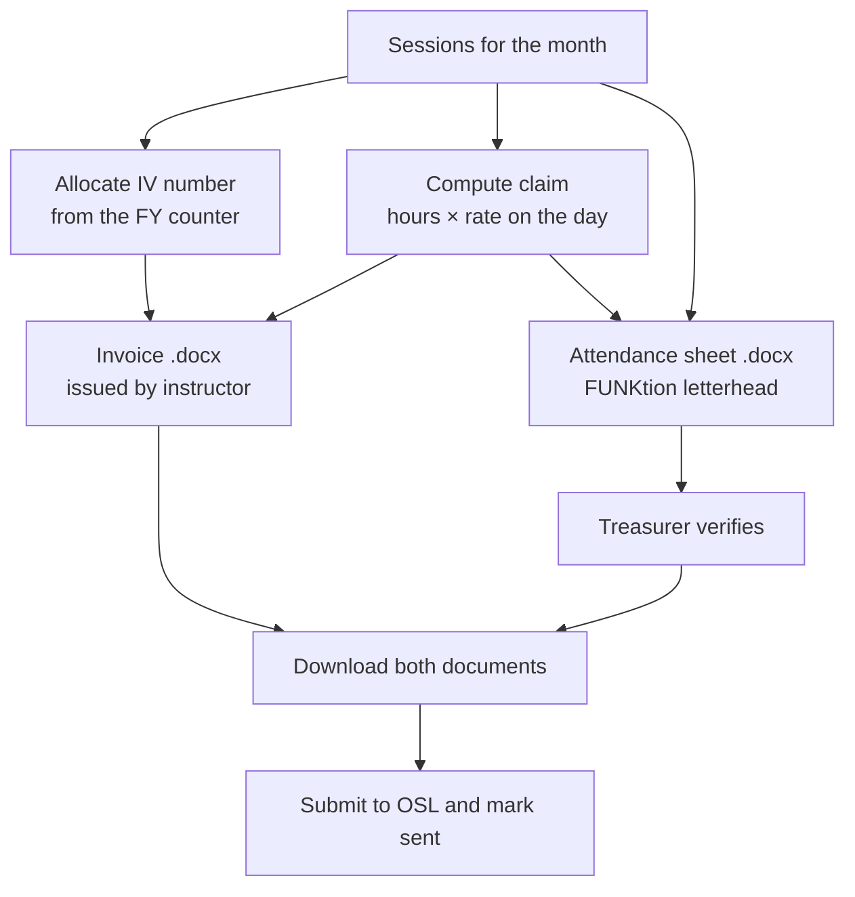

<div align="center">


# FUNKtion Treasury

**The treasury portal for FUNKtion — SUTD's popping &amp; locking dance club.**

Every fact gets entered once. Every document is a rendering of it.

[](https://nextjs.org)
[](https://react.dev)
[](https://www.typescriptlang.org)
[](https://www.prisma.io)
[](https://supabase.com)
[](#testing)


</div>

## What this is

The treasurer's month is mostly transcription. The same four facts — which classes ran, who
attended, what the instructor is owed, which fund it comes from — get typed into an invoice, an
attendance sheet and a register by hand, on the 15th of every month. Fee collection is worse: the
club has never kept a record of who actually paid, only a lump sum banked once a term.

This portal makes each of those facts get entered exactly once, and derives every document from
them. It is written against the **SUTD Student Organisations Finance Guidelines (September 2025)**,
and the rules in that document are implemented as validations rather than reminders.

> The full design rationale — schema, artefact classes, phasing, open questions — lives in
> **[`docs/implementation-plan.html`](docs/implementation-plan.html)**. Open it in a browser.


## What it produces

Two classes of artefact, and the distinction drives most of the technical decisions:

| Class | Documents | Format | How the portal treats it |
| :--- | :--- | :--- | :--- |
| **A** | Transaction Register, Unofficial Funds Register | Google Sheets | Edited in place via the Sheets API, behind a diff-and-approve gate with a pre-write snapshot |
| **B** | Invoices, attendance sheets, income deposit forms, PRF, PAF | `.docx` | Composed server-side, handed to the browser as a download. Never written back to Drive |

Class B needs no Google credentials at all, which keeps the trusted surface small. Only the
register requires API access.

### Built today

- **Coach invoice** (`.docx`) — issued *by* the instructor, billed to SUTD, countersigned by the
  club. Rebuilt from the two templates in Drive, which had drifted apart and acquired separate
  faults (shifted column headers, the payee block collapsed into the treasurer's signature, four
  hardcoded lesson rows).
- **Coaches Monthly Attendance Sheet** (`.docx`) — the club's own document, on FUNKtion
  letterhead, verified by the Treasurer. A member-by-date matrix of YES/NO with the instructor as
  its first row.
- **Reference numbering** — the four OSL series, allocated atomically.
- **Sign-in** — Google OAuth and email/password, both provisioning the application user row that
  every membership, signature and audit entry hangs off.
- **Dashboard** — fund balances, where each reference series stands, and what is blocking the
  month.
- **Instructors** — contracted coaches and guests, their contact and bank details, and a rate
  history that is appended to rather than edited, so a submitted invoice keeps the rate it was
  raised at.
- **Classes, attendance import and monthly run** — record attendance manually or review and apply
  a trimester CSV, raise each coach's month, download both documents, and mark the submission sent.
- **Register** — read-only history imported from the official and unofficial registers.
- **Access requests** — members can request exco access and a different exco member must decide it.
- **Row-level security** — the `app_user` role, policies on every table, and an append-only audit
  path that stamps the actor from the connection rather than accepting it as an argument.

Both documents derive from one list of sessions, so they cannot disagree about how many classes
the coach actually taught.


## The monthly run



The document model understands self-practice dates, where the club met without a coach and nobody
bills. The current `ClassSession` schema still requires an instructor, so recording those dates in
the portal remains open work.


## Quick start

**Requirements:** Node 20+, Docker (for the local Supabase stack).

```bash
cp .env.example .env
docker compose up -d
```

GoTrue and the Storage API run their own internal migrations on boot. Wait for those to settle,
then:

```bash
npm install
npm run db:deploy    # apply application migrations
npm run db:seed      # opening state for FY2026
npm run dev
```

Open <http://localhost:3000>.

### After changing the Prisma schema

`npm run db:generate` rewrites the client inside `node_modules`, and a running dev server has
already loaded the old one. **Restart `npm run dev`** — nothing else picks the change up, and
neither Turbopack's hot reload nor touching a source file is enough.

The failure is not obvious, because it does not look like a stale client. A new model reads as
`Cannot read properties of undefined` on the delegate; a new enum value reads as
`Value 'X' not found in enum`. Both surface as a 500 from whichever page happens to touch it
first, which is rarely the page you just edited.

For the local stack, `.env` must keep `NEXT_PUBLIC_SUPABASE_URL` at `http://localhost:8000` (Kong,
not the Postgres port and not GoTrue directly), use the anon JWT as
`NEXT_PUBLIC_SUPABASE_PUBLISHABLE_KEY`, and use the service-role JWT only as the server-side
`SUPABASE_SECRET_KEY`. Change the example JWTs, database passwords and autoconfirm settings before
using the stack for anything beyond local development. The first-boot SQL in `supabase/init.sql`
only runs when the Postgres volume is initialised for the first time.

### What the seed sets up

| | |
| :--- | :--- |
| Organisation | `funktion`, project code **097**, Arts cluster (A3006) |
| Fund accounts | Seed `PC-00097-A3006-A3006-000` @ **$305.00**, cut-off 28 Feb 2027, no rollover · Income `PN-00097-A3006-A3006-000` / `-R00` @ **$3,615.16** |
| Counters | **IV @ 0010**, SCF/PO/INC @ 0001 |
| Instructors | JIN (Locking), KS (Popping) at $90.00/hr from 1 Apr 2026 |
| Terms | Trimester 2 2026 (18 May – 22 Aug) · Trimester 3 2026 (14 Sep – 19 Dec) · Trimester 1 2027 (25 Jan – 1 May), $70 full / $35 half |

Opening balances come from the FY2026 Transaction Register, with one correction to the Seed Fund —
see **Known gaps** for why the register's own cell reads $1,520.00 and the true figure is $305.00.
Collection dates are left unset on every term: the exco choose them, and every §2.2 deadline counts
from there rather than from the term boundary.

IV opens at 0010, not 0001: numbers 0001–0009 are already on documents sitting with the Office of
Finance. Instructor addresses and bank accounts are deliberately **not** seeded — they are personal
data belonging to someone who did not agree to have it in a git repository, so they are entered
once through the portal. Until they are, `assertInvoiceable()` refuses to generate that coach's
invoice.


## Architecture

The application is split by responsibility without a runtime plugin layer. `core` holds shared
auth, data access and UI; domain code lives in `modules`; routes compose the two. Navigation and
role permissions are ordinary static data because every feature ships with this application.

```
src/
├── core/
│   ├── auth/             # Supabase SSR clients, DAL, organisation context
│   ├── db/               # dbAs() is RLS-scoped; dbAdmin() is core-only
│   ├── permissions/      # static role permissions
│   ├── audit/            # financial write audit trail
│   ├── storage/          # private Supabase bucket and signed URLs
│   └── ui/               # primitives and application shell
├── modules/
│   ├── attendance/       # attendance CSV parsing
│   ├── coach-claim/      # sessions, claims and generated documents
│   ├── references/       # OSL numbering and atomic allocation
│   └── register.ts       # static navigation entries
├── app/                  # Next.js App Router
└── proxy.ts              # session refresh and route protection
```

Outside `src/`: `prisma/schema/` is split by domain (`_base`, `identity`, `organisation`,
`finance`, `audit`); `templates/official/` holds the OSL forms the generated documents have to
satisfy, as reference rather than as input — nothing reads them at build time; `supabase/` holds
the first-boot SQL and Kong config for the local stack; `docs/` holds the implementation plan and
the brand assets this README uses.

### Three invariants worth knowing

**Money is integer cents, everywhere.** The OSL register quotes two decimals and derives the net
from the gross by division (`net = gross / 109 × 100`), so a float representation drifts against
the very document the portal has to reconcile with. `sessionAmountCents()` rounds once — a 90-minute lesson at $90/hr is
`$135.00`, and no arrangement of the same numbers is allowed to produce `$134.99`.

**Reference numbers are allocated, never computed.** A single atomic `UPDATE … RETURNING` against
the counter row, inside the same transaction that writes the document, with a unique constraint on
`(orgId, series, financialYear, sequence)`. Application-level `max + 1` is the classic way to issue the
same invoice number twice under concurrency, and it stays invisible until OSL rejects a
submission. A missing counter throws rather than defaulting to `0001` — guessing would reissue
numbers already in circulation.

**Rates resolve per session, not per invoice.** "The instructor's rate" is only meaningful with a
date attached: rates rise at term and year boundaries, and guests are booked per workshop. A month
that straddles a rise bills correctly on both sides without anyone noticing it straddled one. A
missing rate throws — inventing one produces an invoice that looks authoritative and is wrong.

### Access control

Two roles. **Exco** see and do everything; **members** see their own record and nothing else.
Alongside the role, an exco member holds an *office* (president, treasurer, secretary…) which
confers no access at all — it only decides who gets notified and whose title prints under a
signature. Keeping offices as labels means a mid-year reshuffle is a dropdown rather than a
security decision.

Authorisation is server-side on every mutation. `dbAs()` opens a transaction as `app_user` with
the caller's claims installed, so Postgres row-level security evaluates every query. `dbAdmin`
bypasses RLS and is confined to `src/core/**` by ESLint. Amounts are computed server-side; the
browser never posts a dollar figure. The RLS policies, grants and `write_audit_log()` function are
in `20260909120000_rls_hardening`, and `npm run db:verify-rls` checks the deployed role directly.


## Rules the portal enforces

These are validations applied before a document will generate or submit, not reminders. Each one
lands with the phase that owns it — the coach-document rules below are live today; the fee,
procurement and register rules arrive with phases 02, 04 and 05.

| Rule | Source | Enforcement |
| :--- | :--- | :--- |
| Income carries 9% GST; donations are exempt | §2 | GST derived, never entered |
| Income Deposit Form due within 1 working day of final collection | §2.2 | Countdown + reminder |
| OSL told 2 weeks before collection to open the DBS Max wallet | §2.2 | Blocks opening a term whose lead time has lapsed |
| Seed Fund does not roll over; cut-off around end of February | §2.3 | Hard deadline on the fund account |
| Purchases below $300 → PRF, treasurer only | §3.1.1 | Form type derived from the amount, never chosen |
| $300–$999.99 → PAF, 3 quotations, treasurer + president | Table 1 | Cannot submit with fewer quotes unless an exemption is recorded |
| $1000 and above → PAF, 3 quotations, + OSL approval | Table 1 | Adds a third approval stage |
| Approval must precede the purchase | §3.1.1 | Purchase date cannot precede final approval |
| Invoice to OSL within 3 working days, as one PDF | §3.1.2 | Due date computed on generation |
| Coach documents submitted by the 15th of the following month | §3.3 | Drives the monthly run |

### Reference numbering (§4.4)

Four independent series, each resetting to `0001` at the start of the financial year (April–March).
The hyphens are mandatory.

| Series | Document | FY2026 form |
| :--- | :--- | :--- |
| `IV` | Invoice | `IV26-097-0008` |
| `SCF` | Student Expense Claim | `SCF26-097-0001` |
| `PO` | Purchase Order | `PO26-097-0001` |
| `INC` | Income Deposit Form | `INC26-097-0001` |

Issued numbers are never deleted. Voiding a document marks the number void with a reason, so a gap
in the series has an answer.


## Scripts

| Command | What it does |
| :--- | :--- |
| `npm run dev` | Development server |
| `npm run build` / `start` | Production build and serve |
| `npm run lint` | ESLint, including the `dbAdmin` boundary rule |
| `npm run test` / `test:run` | Vitest, watch / single-run |
| `npm run test:e2e` | Playwright |
| `npm run db:migrate` | Create and apply a migration in development |
| `npm run db:deploy` | Apply pending migrations to the target database |
| `npm run db:push` | Push schema without a migration (local only) |
| `npm run db:studio` | Prisma Studio |
| `npm run db:seed` | Opening state for FY2026 (idempotent) |
| `npm run db:verify-rls` | Connects as `app_user` and checks RLS is actually enforcing |
| `npx tsx scripts/db/import-attendance.ts <file> "<term>" [--apply]` | Dry-run or apply a back-catalogue attendance CSV |

## Testing

```bash
npm run test:run
```

The unit suite covers money and rate arithmetic, claim assembly, document composition, reference
allocation, permissions, audit, attendance parsing and UI primitives. It runs without a database.

The allocator's concurrency guarantee still needs an integration test against a throwaway Postgres
database; the unit suite verifies its SQL and transaction contract only.

CI (`.github/workflows/ci.yml`) runs typecheck, lint and unit tests, then applies the full
migration set to a bare Postgres — with `scripts/ci/stub-supabase-schema.sql` standing in for the
Supabase platform schema — and runs `verify-grants.sql` against the result. That last check reports
its own state: it asserts the `app_user` / `authenticated` grant split when the role exists, and
skips with a notice while it doesn't, so a green build never reads as a security claim it isn't
making.

`npm run test:e2e` currently covers the auth pages only. The rest of the Playwright suite drove the
HR product's routes and went with it.


## Deployment

Once per environment, beyond `npm run db:deploy`:

1. **Migrations are not automatic.** `npm run build` (what Vercel runs) does not run
   `prisma migrate deploy`. Merging to `main` deploys the code; it does not apply schema or RLS
   changes. Run `npm run db:deploy` against the target database as its own explicit step after
   every merge containing a migration, and confirm it landed:
   ```sql
   SELECT migration_name, finished_at FROM _prisma_migrations ORDER BY finished_at DESC LIMIT 5;
   ```
2. **Storage bucket.** Nothing creates the private documents bucket automatically. Run
   `npx tsx scripts/create-storage-bucket.ts` once against the target project — it is idempotent.
   Skipping it means the first upload fails.
3. **Create `app_user`, before the migration.** Run `scripts/db/create-app-user.sql` once in the
   Supabase SQL editor with a generated password pasted in (`openssl rand -base64 24`). It has to
   run as `postgres`: Prisma migrates as `funktion_migrate`, which owns every table but has no
   CREATEROLE and is not a member of `authenticated`, so it can neither create the role nor grant
   it the membership the policies are written against. The RLS migration checks for the role and
   refuses with a pointer back to this file if it is missing, so running them out of order fails
   loudly instead of recording a half-applied migration.

   Then set `APP_USER_DATABASE_URL` to that role's own connection string. Hosted Supabase blocks
   `SET ROLE` to any role outside its platform allowlist, so `app_user` can only be reached by
   connecting to it directly; without this `dbAs()` raises `RlsScopeError` rather than running
   unscoped. Local and self-hosted Postgres have no such restriction and fall back to `SET ROLE`.
4. **Enable the Google provider.** Sign-in is wired end to end in the app, but the provider itself
   is Supabase dashboard configuration. Two different redirect settings are involved and they are
   not the same URL:

   | Where | Value |
   | :--- | :--- |
   | Google Cloud Console → Authorised redirect URIs | `https://<project-ref>.supabase.co/auth/v1/callback` |
   | Supabase → Authentication → URL Configuration → Redirect URLs | `{NEXT_PUBLIC_APP_URL}/auth/callback` |

   The first is where Google returns to Supabase; the second is where Supabase returns to this app.
   Miss the second and sign-in completes at Google then dies on the way home. Add every origin the
   app is served from — `http://localhost:3000/auth/callback`, the production domain, and
   `https://*-<team>.vercel.app/auth/callback` if you want preview deployments to work.

   Publish the Google consent screen rather than leaving it in Testing: testing-mode refresh tokens
   expire after seven days, which will matter when Drive access lands in 02b and will look like the
   code broke a week after it started working.
5. **Set `NEXT_PUBLIC_APP_URL` per environment.** It is what the OAuth redirect is built from. On
   Vercel it must be the deployment's own URL, not `localhost` — the code falls back to
   `VERCEL_URL` when it is unset, which keeps preview builds working, but production should be
   explicit so the URL does not change under you.
6. **Self-hosted CORS origin.** `supabase/kong.yml` hardcodes `http://localhost:3000` as the only
   allowed origin. Edit the `origins` list before pointing a self-hosted deployment at a real
   domain.


## Roadmap

| | Phase | Status |
| :--- | :--- | :--- |
| **01** | Invoice and attendance generation | Complete for coach-led sessions: sessions, attendance, generation, downloads and submission tracking are live |
| **01b** | Access — invitations, promotion requests and revocation | Partly built: promotion requests and independent approval are live; invitations and revocation are not |
| **02** | Fee collection — PayNow declaration, exco reconciliation, Income Deposit Form | Planned |
| **02b** | Attendance CSV import and stored signatures | CSV upload, review and apply are live; signature storage is not |
| **03** | Automated reminders and Telegram delivery | Planned |
| **04** | Procurement — PRF/PAF thresholds, quotations, approval chain | Planned |
| **05** | Transaction Register sync, behind diff-and-approve | Read-only import is live; writeback is planned |
| **06** | Handover — FY2027 rollover, all four counters reset to 0001 | March 2027 |

The schema for every phase already exists in `prisma/schema/finance.prisma`; the phases above are
the UI and workflow on top of it.

### Known gaps

The remaining product work is:

| Missing | Consequence |
| :--- | :--- |
| Self-practice sessions | The document model supports them, but `ClassSession` still requires an instructor |
| Re-raising a voided month | Voiding works; generating a replacement with a fresh reference does not |
| Stored signatures and instructor photos | The private-storage base exists; these uploads do not |
| Invitations and revocation | Promotion requests work, but the rest of the member-access lifecycle does not |
| Fee collection and Income Deposit Form | Schema only |
| Reminders, Telegram and production auth email | Delivery and scheduling are not configured |
| Procurement forms and approvals | Schema only |
| Register writeback | The imported history is read-only; diff-and-approve sync is not built |
| FY2027 handover | Counter rollover and handover workflow are not built |

**One number worth knowing before FY2026 is reconciled.** The register's Seed Fund balance cell
reads `$1,520.00`, but the balance formula subtracts the *without-GST* column and the four June and
July coach rows have their incl-GST cell filled with that cell left blank. Those four total
`$1,215.00`, so the displayed balance overstates the fund by exactly that. The real figure is
`$2,600.00 - $2,295.00 = $305.00`, and that is what the seed carries. The Income section has both
GST columns populated on every row and needs no such correction.

The same four rows carry no reference number in the register at all, which leaves only IV
`0009` to account for four submitted documents. Either three numbers were issued and never written
back to the sheet, or three submissions went out unnumbered — a question for OSL rather than for
the code. Opening the counter at `0010` is safe under either reading.


## Design language

The logo is one shape stacked four times — vermilion, marigold, sky, indigo — each offset down and
right, like the layers of a *kueh lapis*. That is a system, not just a mark, and the interface runs
on it: buttons sit on a hard offset shadow in the next layer colour and collapse into it when
pressed; cards carry a stacked edge whose depth encodes importance; focus is a full offset outline
in vermilion.

Layer order is fixed, front to back, which is what makes the device read as the logo rather than as
decoration.

Where it stops: registers, figures and tables stay quiet on plain ground in tabular figures. A
finance screen has to be read quickly and trusted. Offset alone never carries meaning that colour
or text does not also carry — depth is invisible to a screen reader — and the press animation is
dropped entirely under `prefers-reduced-motion`.

```
#F05820   #F8A838   #58C0E8   #304890
vermilion marigold  sky       indigo
```

<div align="center">


Drafted against the SUTD Student Organisations Finance Guidelines, September 2025.

</div>
